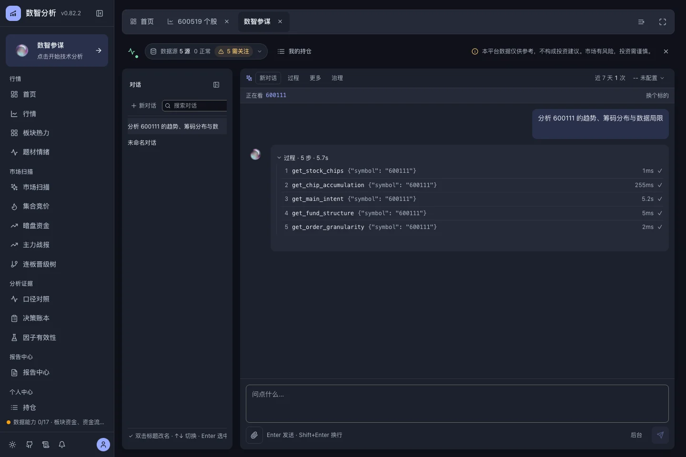
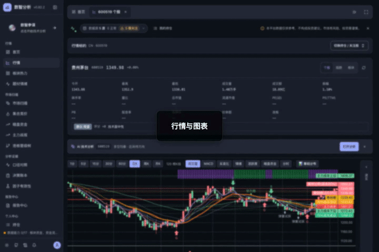
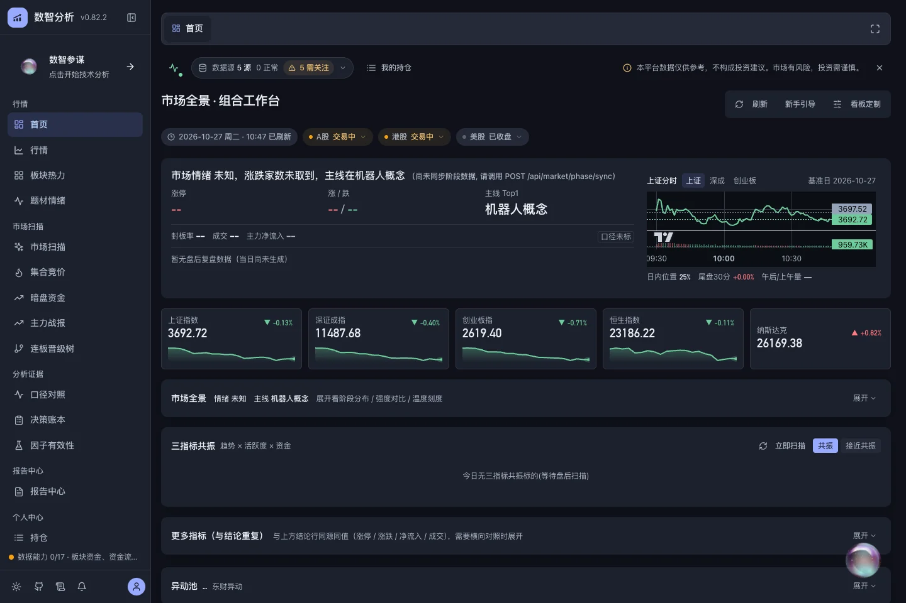
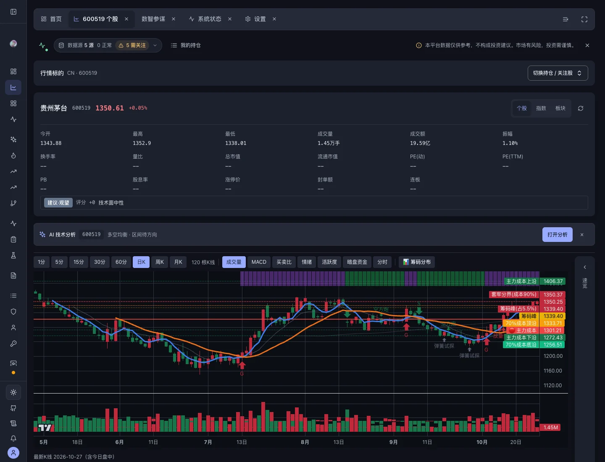
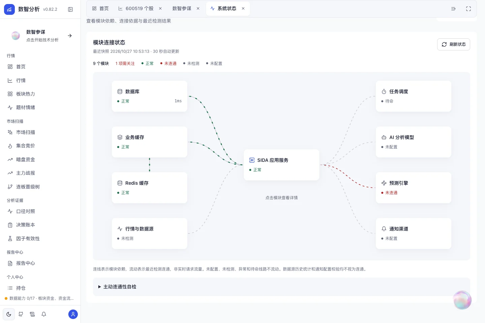
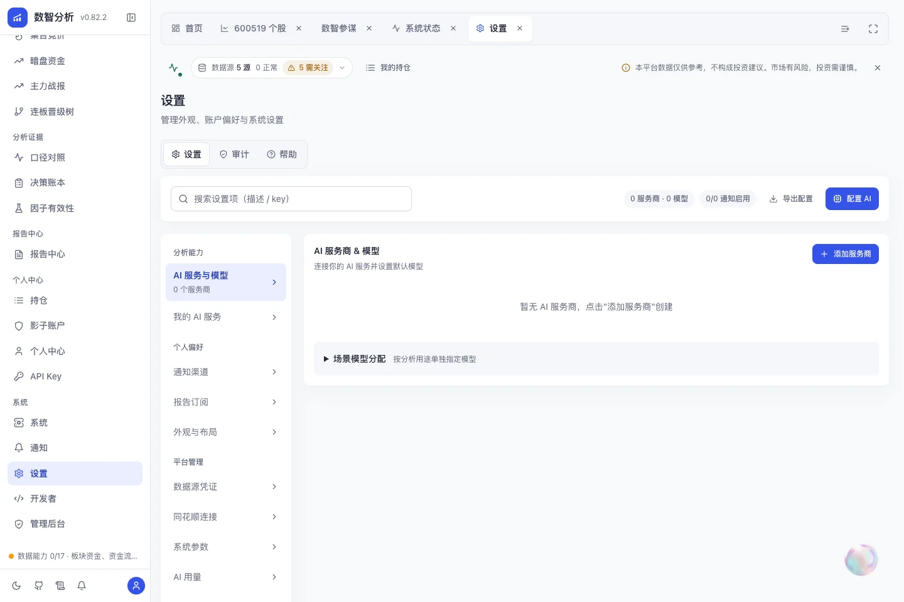
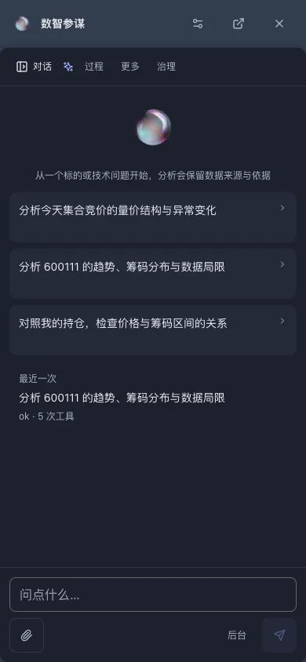

<div align="center">

# SIDA Pro · Stock Intelligent Data Analytics

**Backtest an idea. Check the AI's evidence. Get alerted when it matters.**

[](LICENSE)
 <!-- Keep aligned with VERSION. -->

[中文](README.zh-CN.md) · [Capabilities](#capabilities) · [Operation demos](#operation-demos) · [Setup guide](#getting-started) · [Developer API](https://sida.win/developers)

</div>

SIDA Pro is a self-hostable **quantitative research workspace for China's A-share market**. Scan the market for candidates, test ideas with factor analysis, historical backtests and paper trading, and review the data and tool calls behind an AI diagnosis. Configure notifications to follow reports and alerts outside the dashboard. External agents and scripts can call research tools through the **Skill API**.

> **Try asking: “Do the money flow, cost distribution and price action tell the same story for this stock?”** The built-in copilot can use the current symbol to select research tools. Open the run to inspect tool parameters, status and timing before drawing your own conclusion.



> Screenshots and recordings: **2026-10-27 · v0.82.2**, real local browser sessions. Quotes are historical capture snapshots, not live prices or performance claims. Missing data, unconfigured models and disconnected optional services are preserved honestly.

## Operation demos

Project repository: [SIDA Pro](https://github.com/xiaoze-hub/sida-pro). For the free self-hosted community edition, visit [Stock-Intelligent-Data-Analytics](https://github.com/xiaoze-hub/Stock-Intelligent-Data-Analytics) and its deployment guide. The community edition uses AGPL-3.0; its capabilities and releases are separate from this Pro instance.

[](frontend/public/media/product/market.mp4)

**Click the preview to open the MP4.** The public landing page provides an inline player, poster, Chinese captions and written steps. GitHub may open repository videos as files rather than inline players.

| Walkthrough | What it demonstrates | Video / captions |
| --- | --- | --- |
| Market workspace · 31 s | Open holdings/watchlist picker, switch K-line periods and toggle MACD | [MP4](frontend/public/media/product/market.mp4) · [VTT](frontend/public/media/product/market.zh.vtt) |
| AI workspace · 25 s | Reopen an existing conversation, expand tool steps and inspect the run panel | [MP4](frontend/public/media/product/assistant.mp4) · [VTT](frontend/public/media/product/assistant.zh.vtt) |
| System status · 18 s | Inspect module connections, open database details and refresh the snapshot | [MP4](frontend/public/media/product/system.mp4) · [VTT](frontend/public/media/product/system.zh.vtt) |
| Mobile assistant · 16 s | Full-screen conversation, single-line input and Enter for a new line | [MP4](frontend/public/media/product/mobile.mp4) · [VTT](frontend/public/media/product/mobile.zh.vtt) |

The AI clip replays an existing tool history; it does not generate or imply a new AI conclusion. The mobile clip edits a draft without submitting it. Recording scope, limitations and reusable promotion copy are in [the media guide](docs/PRODUCT_DEMO.md).

## Capabilities

| Module | Purpose |
| --- | --- |
| **Market scanning** | Indices and ETFs, sector heatmaps, theme sentiment, limit-up streaks, call auctions and candidate scans. |
| **Stock and flow data** | Quotes, technical indicators, cost distribution, fundamentals and news, large-trade analysis, comparisons of flow methodologies, exchange trading disclosures and quarterly institutional holdings. |
| **Quant research and strategy testing** | Factor IC, IR and out-of-sample checks. The backtest API runs the built-in moving-average crossover strategy with configurable holding periods, stops and targets, returning trades, an equity curve and metrics. Paper trading and a decision ledger are separate tools. |
| **AI analysis and native agents** | The copilot uses the active symbol and workspace context to call research tools or run specialized auction, theme and risk workflows. Runs are inspectable; proposed chart annotations require user confirmation. |
| **Forecasting experiments** | Optional forecast engines expose model comparisons and historical validation, separate from strategy backtesting and paper trading. |
| **Portfolio and trade review** | Account-scoped holdings and watchlists, shadow-account trade imports, reports and analysis history. |
| **Multi-channel notifications** | Schedule or subscribe to reports and alerts; deliver in-app or through configured channels such as WeChat, WeCom and Telegram. |
| **Skill API** | Browse the [Skill catalog](https://sida.win/api/skills/catalog) and invoke quote, technical analysis and trading-flow skills over HTTP. See the [developer documentation](https://sida.win/developers) for authentication, permissions and quotas. |
| **Deployment and governance** | Multi-user permissions, model and channel settings, agent run history and usage, and service and data-source health. |

Backtesting is currently API-based, not a visual strategy editor. Paper trades are simulated, not live orders. Backtests and AI output are not investment advice or promises of returns.

### Interface gallery

| Market overview | Stock workspace |
| --- | --- |
|  |  |
| **Service connection map** | **Categorized settings** |
|  |  |

<details>
<summary>View the mobile assistant</summary>



</details>

## Data and capability boundaries

- **Sources are distinct.** Tick-based intent, Eastmoney amount buckets and TQ L2 figures use different definitions. Source/caliber labels matter; they must not be treated as interchangeable directional signals.
- **Missing means missing.** Unavailable fields show `--` / no data, with baseline dates and availability hints where applicable.
- **AI is configurable.** Configure a model/provider before using AI. Outputs depend on that model and the available inputs; no guaranteed accuracy or returns.
- **Optional services stay optional.** Forecast engines, notification delivery, private data gateways and automated schedules need their own setup. A healthy HTTP endpoint does not prove every data source works.
- **Multi-user context matters.** Holdings, watchlists, conversations and user channel settings are scoped to accounts.

## Getting started

Choose the setup that matches your environment. **Production uses PostgreSQL/TimescaleDB; SQLite is only for local development and isolated tests.** Redis supports shared caching and coordination.

| Path | Instructions |
| --- | --- |
| Existing instance | Open its home page, watch the demos and sign in. Registration depends on the administrator's policy. |
| Local Docker development | Follow [Local Docker setup](docs/knowledge-base/local-docker.md): app + PostgreSQL + Redis, source mounts and optional forecast engine. Its cached arm64 runtime is host-specific; review the base-image requirements. |
| Standard deployment | Review [architecture and environment](docs/knowledge-base/architecture.md), `.env.example` and `docker-compose.yml`; set credentials, database/cache access and optional service configuration before starting. |
| Source development | Prepare the database and `.env`, then run the commands below in separate terminals. |

```bash
# Backend :8000 (creates the virtual environment and installs dependencies)
make dev-api

# Frontend :5183 (installs dependencies and starts Vite)
make dev-web

# Validate media, TypeScript and the production frontend build
pnpm --dir frontend build
```

Use hot reload or rebuild the frontend for routine source changes. Rebuild the Docker image when packaged dependencies or release assets change. Do not delete data volumes during routine updates.

The official public site is [sida.win](https://sida.win/). Public overview, developer docs and account plans share server-generated SEO metadata, social previews and a three-page sitemap. Self-hosted deployments can set `SIDA_PUBLIC_SITE_URL` to their own origin and `SIDA_SEO_INDEXABLE=false` for private instances; localhost HTML and workspace routes are not indexed. These settings are documented in `.env.example` and passed through the main Compose service.

## Architecture and integrations

React + TypeScript + Vite → FastAPI → PostgreSQL/TimescaleDB + Redis. Collectors supply market data; agents and Skill APIs coordinate analysis; model providers and notification channels are configured separately.

Integrations include [TradingAgents](https://github.com/TauricResearch/TradingAgents), [Kronos](https://github.com/shiyu-coder/Kronos), [Chronos](https://github.com/amazon-science/chronos-forecasting), XGBoost and TA-Lib. Availability depends on the installed engines, runtime and data. Charts use [Lightweight Charts](https://github.com/tradingview/lightweight-charts); optional observability configuration lives in `docker-compose.infra.yml`.

- [Project guide](docs/knowledge-base/README.md) · [Architecture](docs/knowledge-base/architecture.md)
- [UI guidelines](docs/UI_GUIDELINES.md) · [Demo media and promotion copy](docs/PRODUCT_DEMO.md)
- [TDX formula pack](docs/tq-formulas/README.md): installation steps, parameters and divergence statements versus SIDA

## Disclaimer

SIDA is a technical research tool. AI outputs, chart annotations, forecasts and reports are for reference only, **not investment advice or stock recommendations**. They do not guarantee returns. Market data may be delayed, incomplete or unavailable. Markets involve risk; decisions remain your responsibility.

---

## Get Help

Need help with the docs or applying for an API Key (Market Data API)? Join our WeChat group:


> If the QR code expires, contact us on WeChat at `winter1920977`.

---

## Sponsor

If SIDA helps you, consider buying the author a coffee ☕ — your support keeps this project alive!

| Method | Entry |
|:---:|:---:|
| **WeChat Reward** |  |

> Tip: click ⭐ **Star** on the top-right to support the project.
