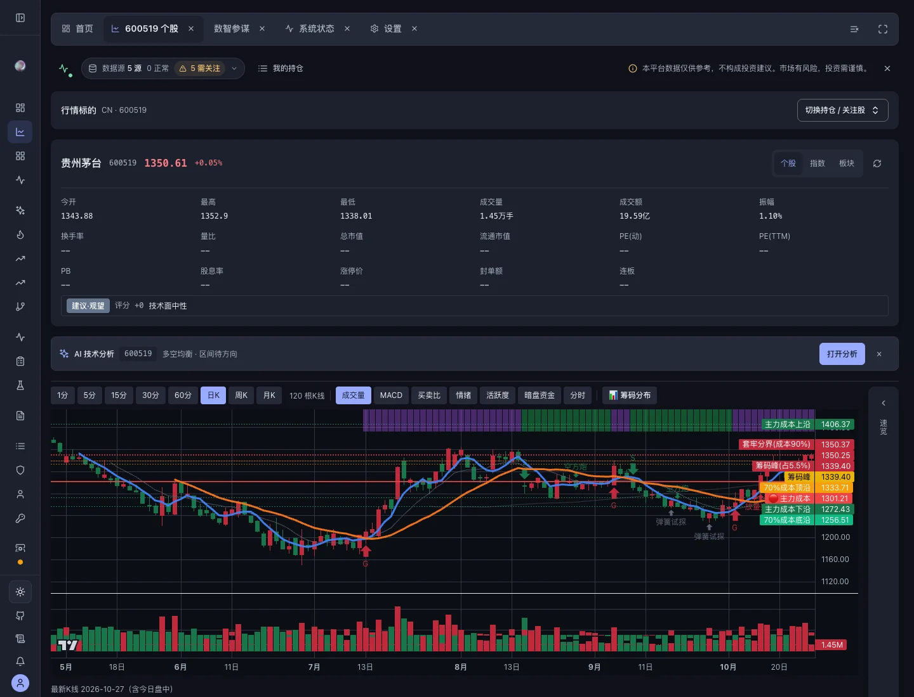
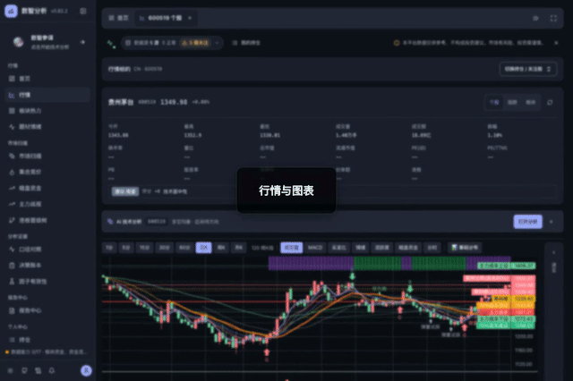
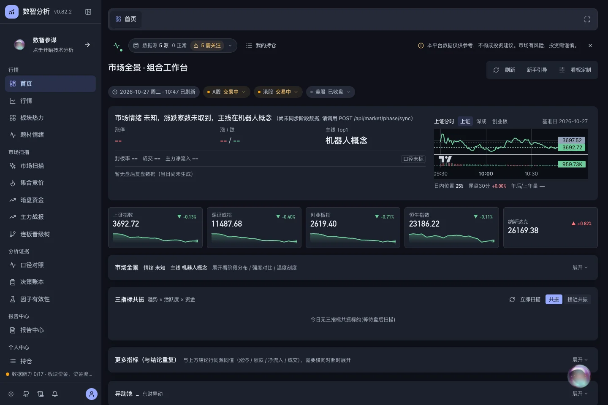
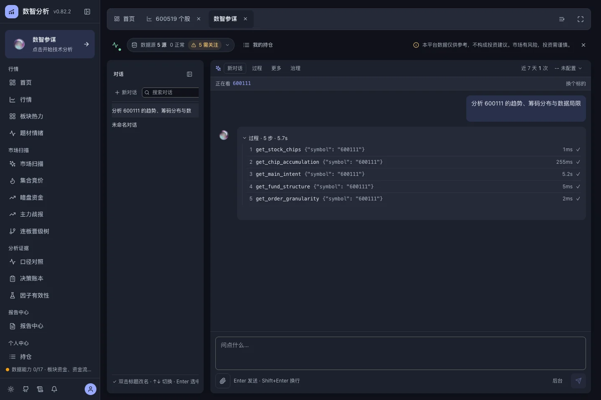
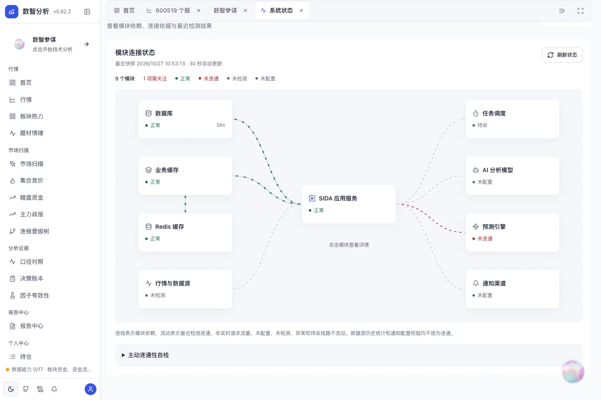
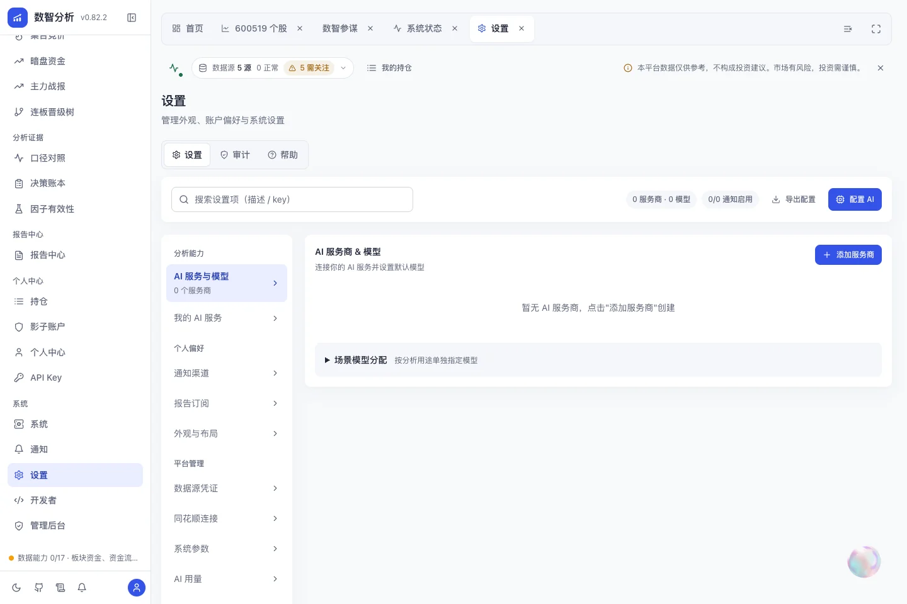
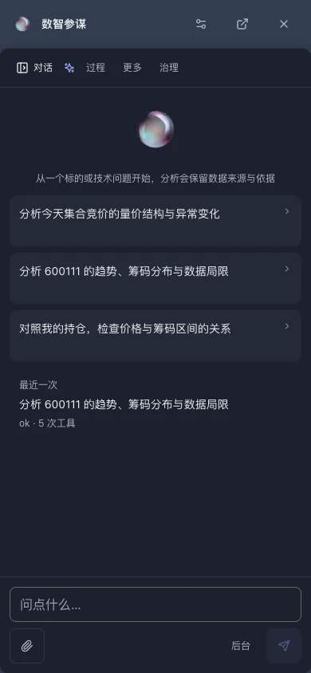

<div align="center">

# 数智分析 Pro · SIDA Pro

**把市场全景、个股图表、关注列表与 AI 技术分析，连接成有据可查的个人研究工作流。**

[](LICENSE)
 <!-- Keep aligned with VERSION. -->

[English](README.md) · [操作演示](#操作演示) · [开始使用](#开始使用) · [项目知识库](docs/knowledge-base/README.md)

</div>



SIDA 面向个人股票技术研究：先了解市场，再查看标的，通过 AI 提出问题，最后回看数据、工具过程与分析记录。支持自行部署，项目采用专有许可，集成的第三方项目遵循各自许可证。

> 截图与视频录制于 **2026-10-27 · v0.82.2**，来自真实本地浏览器。画面是当时的数据与配置快照，不是实时行情或实盘业绩。缺失数据、未配置模型和未连接的可选服务均如实保留。

## 操作演示

项目仓库：[SIDA Pro](https://github.com/xiaoze-hub/sida-pro)。免费自行部署请前往[社区开源版 Stock-Intelligent-Data-Analytics](https://github.com/xiaoze-hub/Stock-Intelligent-Data-Analytics)，按仓库说明安装。社区版采用 AGPL-3.0，其功能与发布节奏和当前 Pro 实例分别维护。

[](frontend/public/media/product/market.mp4)

**点击预览图打开 MP4 视频。** 官网落地页内置封面、播放器、中文字幕与文字步骤；GitHub 可能以文件形式打开仓库视频，不保证直接内嵌播放。

| 演示 | 操作内容 | 视频 / 字幕 |
| --- | --- | --- |
| 行情工作台 · 31 秒 | 打开持仓 / 关注列表，切换 K 线周期与 MACD 指标 | [MP4](frontend/public/media/product/market.mp4) · [VTT](frontend/public/media/product/market.zh.vtt) |
| 数智参谋 · 25 秒 | 重开已有会话，展开工具步骤并查看运行面板 | [MP4](frontend/public/media/product/assistant.mp4) · [VTT](frontend/public/media/product/assistant.zh.vtt) |
| 系统状态 · 18 秒 | 查看模块连接，打开数据库详情并刷新快照 | [MP4](frontend/public/media/product/system.mp4) · [VTT](frontend/public/media/product/system.zh.vtt) |
| 手机助手 · 16 秒 | 全屏对话、默认单行输入与回车换行 | [MP4](frontend/public/media/product/mobile.mp4) · [VTT](frontend/public/media/product/mobile.zh.vtt) |

AI 短片回放已有工具历史，没有生成或暗示新的 AI 结论；手机短片只编辑草稿，没有提交分析请求。录制范围、限制与可复用推广文案见[媒体说明](docs/PRODUCT_DEMO.md)。

## 核心工作流

| 模块 | 用途 |
| --- | --- |
| **市场全景** | 指数走势、市场上下文与可折叠、可定制的首页看板 |
| **个股工作台** | 从持仓 / 关注列表选股，切换 K 线周期、技术指标与筹码视图，核对来源 |
| **数智参谋** | 完整页与悬浮迷你窗共用会话，工具步骤与运行记录可回看 |
| **分析证据** | 口径对照、决策账本、因子有效性，帮助辨别指标定义与分析依据 |
| **个人工作区** | 按账号管理持仓、关注列表，导入影子账户交割单并分析 |
| **报告与通知** | 查看报告、设置订阅与通知渠道；调度和投递需完成配置 |
| **系统状态** | 模块依赖连接图、缓存时间、增量刷新与连接检测依据 |
| **设置与 API** | 分类管理模型服务、外观和通知，通过 API Key / Skill 接口集成 |

### 界面截图

| 市场全景 | 分析过程 |
| --- | --- |
|  |  |
| **系统连接状态** | **分类设置** |
|  |  |

<details>
<summary>查看手机助手界面</summary>



</details>

## 数据与能力边界

正式官网：[sida.win](https://sida.win/)。公开首页、开发者文档与账户方案共用服务端 SEO 元信息、分享预览与三页 sitemap；自部署可用 `SIDA_PUBLIC_SITE_URL` 指定自己的公开域名，私有实例设 `SIDA_SEO_INDEXABLE=false` 关闭索引。本地 HTML 与工作区功能页不参与索引，配置示例见 `.env.example`，主 Compose 服务已透传。

- **口径明确区分。** 腾讯逐笔意图、东财按单金额四档和 TQ L2 指标的定义不同，不能把它们当作可互换的方向性信号。使用时保留来源、口径和基准日。
- **缺失就是缺失。** 不可用的字段显示 `--` / 无数据，不能用猜测补齐。
- **AI 需要配置。** 先配置模型与服务商再使用 AI。分析取决于模型和可取得的数据，不承诺准确率或收益。
- **可选能力需单独准备。** 预测引擎、通知投递、专有数据网关和自动调度各有配置要求；主服务健康不等于所有业务源可用。
- **用户上下文隔离。** 持仓、关注列表、会话与个人通知配置按账号管理。

## 开始使用

按环境选择运行方式。**生产数据库采用 PostgreSQL / TimescaleDB，SQLite 仅供本地开发与隔离单测。** Redis 用于共享缓存与协调。

| 场景 | 操作说明 |
| --- | --- |
| 已有实例 | 打开实例首页查看演示并登录；注册是否开放以管理员设置为准。 |
| 本地 Docker 开发 | 按[本地运行手册](docs/knowledge-base/local-docker.md)准备应用、PostgreSQL、Redis 与源码挂载。手册中的 arm64 缓存基底有机器要求，其他环境需先核对镜像。 |
| 标准部署 | 先核对[架构与环境说明](docs/knowledge-base/architecture.md)、`.env.example` 和 `docker-compose.yml`，配置认证、数据库、缓存与所需服务。 |
| 源码开发 | 准备数据库与 `.env` 后，在两个终端分别运行以下命令。 |

```bash
# 后端 :8000，自动创建虚拟环境并安装依赖
make dev-api

# 前端 :5183，自动安装依赖并启动 Vite
make dev-web

# 检查演示素材、TypeScript 并构建前端
pnpm --dir frontend build
```

日常源码修改使用热更新或重建前端；打包依赖、镜像内容或正式发布变化时再构建 Docker。常规更新不删除数据卷。

## 架构与技术整合

React + TypeScript + Vite → FastAPI → PostgreSQL / TimescaleDB + Redis。采集器提供市场数据，Agent 与 Skill 接口组织分析；模型服务与通知渠道独立配置。

项目整合 [TradingAgents](https://github.com/TauricResearch/TradingAgents)、[Kronos](https://github.com/shiyu-coder/Kronos)、[Chronos](https://github.com/amazon-science/chronos-forecasting)、XGBoost 与 TA-Lib 等能力，可用性取决于引擎安装、运行环境和数据。图表使用 [Lightweight Charts](https://github.com/tradingview/lightweight-charts)，可选可观测性编排见 `docker-compose.infra.yml`。

- [项目知识库](docs/knowledge-base/README.md) · [架构说明](docs/knowledge-base/architecture.md)
- [UI 设计准则](docs/UI_GUIDELINES.md) · [演示素材与推广文案](docs/PRODUCT_DEMO.md)
- [通达信公式包](docs/tq-formulas/README.md)：安装步骤、参数与相对 SIDA 实现的差异说明

## 免责声明

本项目用于技术研究。AI 输出、图表标注、预测与报告均仅供参考，**不构成投资建议或股票推荐**，不保证收益。行情可能延迟、缺失或不可用。市场有风险，投资决策由使用者自行负责。

---

## 使用支持

使用说明、部署问题、问题反馈或申请 API Key（市场数据接口）遇到问题，欢迎加入微信群交流：


> 二维码失效后，请添加微信 `winter1920977` 联系。

---

## 赞助

如果 SIDA 对你有帮助，请作者喝杯咖啡 ☕ — 你的支持让项目持续下去！

| 方式 | 入口 |
|:---:|:---:|
| **微信赞赏** |  |

> 觉得不错的话，点一下右上角 ⭐ **Star** 支持一下吧。
