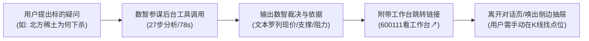
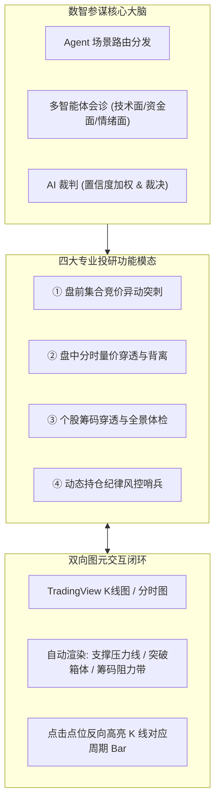
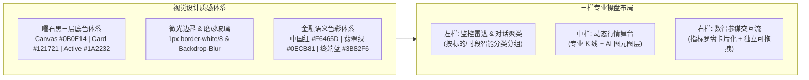
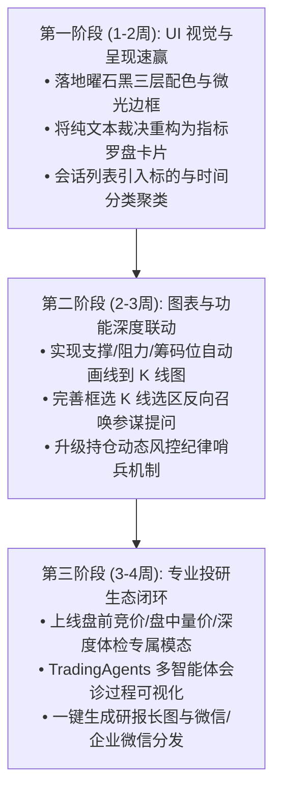

# SIDA Pro「数智参谋平台」深度体验分析与升级优化方案

> **评测基准**：SIDA Pro v0.87.0（恒生数智分析平台）  
> **评测环境**：真实生产环境登录实测（账号：`admin`，包含全屏工作台模式与个股抽屉协同模式）  
> **核心目标**：① **功能层面**深度贴合 A 股股票技术分析与操盘实战；② **UI/UX 层面**打造媲美 Bloomberg Terminal / TradingView / Linear 顶级金融终端的高级质感。

---

## 一、 当前实操体验与核心痛点诊断

通过对 SIDA Pro 的全屏数智参谋（`/ai-copilot`）以及个股关联工作台（`/stocks/600111`）的完整操作，我们还原了当前平台的实际运作闭环：



### 1. 现存核心痛点分析

| 维度 | 当前现状 | 核心痛点与用户摩擦点 |
| :--- | :--- | :--- |
| **图文割裂** | 参谋分析出支撑位 `33.96`、压力位 `38.44`，但仅以纯文本输出 | **无图元联动**：用户看完文本后，还需自己去 K 线图上找对应价格划线，缺乏专业量化工具的交互效率。 |
| **呈现形式** | 输出主要依赖 Markdown 文本、项目符号（`【持仓状态】`、`【需关注价位】`） | **缺乏金融卡片化视觉**：大量文字堆叠，盘中盯盘时扫读效率极低，缺少盈亏比罗盘、筹码压力带等结构化组件。 |
| **会话管理** | 左侧边栏堆积了 50+ 个未分类的单向历史对话，底部提供翻页横向滚动条 | **无投研组织维度**：无法按标的（如稀土板块、北方稀土）、按时段（盘前竞价、盘后复盘）或策略标签聚类检索。 |
| **多模型机制** | 设置里配置了 7 大服务商、58 个模型及 TradingAgents，但前台仅显示一个模型名 | **Agent 协同价值未显性化**：用户感知不到“技术面 Agent”、“资金面 Agent”、“风控裁判”的多方博弈过程。 |
| **UI 质感** | 深色模式背景较为平整单一，卡片边界模糊，字体与留白缺乏高级金融级呼吸感 | **设计语言偏传统中后台**：缺乏顶级 FinTech 的精致微光边缘（Glow）、层次化半透明磨砂质感与专业金融色彩梯度。 |

---

## 二、 功能优化方案：深度贴合股票分析实战

要让“数智参谋”从一个**“问答式 AI 聊天助手”**真正跃升为**“机构级 AI 操盘副驾驶”**，必须实现**数据、图表、规则、决策**四位一体的联动。



### 1. 核心突破：AI 结论与 K 线图元双向实时联动（Bidirectional Charting）
* **自动点位映射与画线（Overlay Injection）**：
  * 当参谋给出“防守位 33.96、压力位 38.44、筹码密集峰 35.80~36.50”时，聊天界面提供 **`[在图表绘制标记]`** 开关（默认自动点亮）。
  * 图表上即时渲染出**半透明带状支撑/阻力通道**、**止盈止损水平射线**以及**形态拐点标注（Annotation Box）**。
* **选区反向召唤参谋（Chart-to-Copilot Drag & Ask）**：
  * 用户在 K 线或分时图上框选某段异常放量下跌区间，右键即触发：*“让参谋解读此选区主力意图与量价背离”*，自动带入区间上下文完成诊断。

### 2. 打造四大股票操盘战术模态（Tactical Modes）
在数智参谋顶部提供专用战术模式切换，针对不同时段的操盘刚需定制模板：
1. **盘前竞价扫描模式（09:15 - 09:30）**：
   * 自动聚合撮合异动：爆量抢筹（竞价金额超前日 20%）、弱转强超预期开盘、封单比异常变化；
   * 风险排查：集合竞价最后 2 分钟大额撤单诱多检测。
2. **盘中量价异动追踪模式（09:30 - 15:00）**：
   * 分时异动穿透：分时放量尖刺、百手以上连续大单、资金回流与指数背离；
   * 关键均线与形态预警：回踩 20 日均线企稳信号、MACD 底背离初现确认。
3. **个股全景深度诊断（日线与波段）**：
   * 筹码结构穿透：获利盘比例、上方套牢盘密集区、平均持仓成本位分布；
   * 多因子共振雷达：量价趋势（MACD/KDJ/均线）、主力资金（暗盘净额/大单沉淀）、板块效应（相对板块 RS 强弱强度）。
4. **持仓纪律哨兵（Position Risk Sentinel）**：
   * 动态推演：结合用户实际持仓成本（如北方稀土成本 36.52），计算当前风险敞口与盈亏平衡点；
   * 阶梯止损止盈预案：保本线、回撤保护线（例如从浮盈高点回落 3% 自动报警提示保护本金）。

### 3. 多智能体会诊显性化（TradingAgents Multi-Agent Debate）
将后台已有的多个专项模型与 Agent 流程具象化为清晰的**“专家评审团”**视图：
* **技术面 Agent**：负责图表走势、均线形态与量能结构评分；
* **资金与暗盘 Agent**：负责龙虎榜席位、主力资金流动向与盘口异动评估；
* **情绪与板块 Agent**：负责当前题材热点排位、连板梯队高度与大盘环境风险度；
* **AI 裁判（Judge）**：整合三方观点，展示加权结论（如：技术面 70 分、资金面 45 分、综合裁决：*轻仓观望，等待放量突破 36.20*）。

---

## 三、 UI/UX 设计方案：顶级金融终端级质感重构

将设计风格从传统中后台的“平铺式表格/表单”，全面升级为 **“现代化顶级暗黑金融终端”**（参考 Bloomberg Anywhere、TradingView Desktop 与 Linear 的美学标杆）。



### 1. 配色与材质体系升级（Obsidian Dark Design System）

* **三层暗黑层次深度（Depth & Elevation）**：
  * **Layer 0 (底层画布)**：`#0B0E14` —— 极具沉浸感的高级冷调暗夜黑；
  * **Layer 1 (面板与卡片)**：`#121721` —— 搭配 `1px solid rgba(255, 255, 255, 0.06)` 的微光轮廓线；
  * **Layer 2 (交互浮层与悬浮状态)**：`#1A2232`，结合 `backdrop-filter: blur(12px)` 的毛玻璃通透感；
* **金融语义色彩规范**：
  * 现有的红色与绿色对比度偏刺眼，建议采用专业高动态色彩：
    * **上涨/资金流入**：`#F6465D`（既醒目又不失稳重）；
    * **下跌/资金流出**：`#0ECB81`（清透翡翠绿，夜间不伤眼）；
    * **AI 智能主色调**：从现有的紫色渐变球换为更具科技穿透力的 **霓虹钴蓝 `#3B82F6` + 极光青 `#06B6D4`**。

### 2. 消息流重塑：“纯文本 Bullet Points” 升级为 “数智裁决指标罗盘”
现有的输出文本堆叠过多文字标签，建议改用结构化**金融卡片 Widget**：

```
+--------------------------------------------------------------------------+
|  北方稀土 (600111) · 盘中量价穿透诊断               [建议: 观望·中性] 62分 |
+--------------------------------------------------------------------------+
|  现价: 35.35 (-0.14%)      持仓成本: 36.52 (-3.2%)     盈亏比: 1 : 2.4     |
|                                                                          |
|  [ 关键价位区间可视化罗盘 ]                                                |
|  防守支撑位: 33.96 <======= [现价 35.35] =======> 密集阻力区: 38.44       |
|  ├─── 距离支撑: -3.9% ───┤                    ├─── 距离阻力: +8.7% ───┤   |
|                                                                          |
|  [ 核心依据清单 (3项共振) ]                                               |
|  * 筹码分布: 36.00~37.50 堆积超 42% 套牢筹码，当前处于缩量洗盘结构        |
|  * 资金轨迹: 主力资金早盘微量流出 1,280万，未见恶性砸盘出逃迹象           |
|  * 板块环境: 稀土永磁板块指数当前承压于 5 日线，联动偏弱                   |
|                                                                          |
|  [ 操盘预案建议 ]                                                         |
|  1. 稳健型: 跌破 33.96 坚决减仓防守；未放量站上 36.20 前不盲目补仓        |
|  2. 激进型: 依托 34.00 整数关口轻仓低吸博弈反弹，跌破即撤               |
|                                                                          |
|  [在K线图叠加标记]   [添加到自选监控哨兵]   [生成复盘战报]   [复制结论]    |
+--------------------------------------------------------------------------+
```

### 3. 工作台空间利用率重构（Professional 3-Column Ergonomics）
* **大屏三栏模式（专业投研者首选）**：
  * **左侧（260px）**：自选/持仓监控雷达 + 参谋会话分类（支持以标的代码/时间折叠分类）；
  * **中间（弹性撑满）**：全功能 TradingView K 线图 + 分时副图 + 筹码带，直观展现图表走势；
  * **右侧（420px 沉浸式参谋流）**：数智参谋卡片交互流，支持全屏展开、侧边吸附或拖拽为独立画中画（PIP）浮窗。
* **移动端与分屏响应式优化**：
  * 在个股抽屉展开时，图表自适应压缩而非简单被遮挡覆盖，保证盯盘与提问同屏可见。

### 4. 细节微交互升级（Micro-Interactions）
* **代码与标的悬浮快照（Smart Ticker Hover Card）**：
  * 会话中出现任意股票代码（如 `@北方稀土` 或 `600111`），鼠标悬停即弹出小尺寸即时分时图、五档盘口与今日涨跌，无需切换标签页；
* **工具链路可折叠流水线（Tool Execution Pipeline）**：
  * 将现有的 `过程 · 27 步 · 78.2s` 从纯日志改为可视化节点链：`行情 RPC (45ms)` → `技术指标计算 (120ms)` → `筹码算法穿透 (310ms)` → `AI 裁判裁决 (1.2s)`，用户一目了然数据的可信与新鲜度；
* **对话流时间与分类归档**：
  * 左侧历史对话支持“今日实战”、“本周复盘”、“历史归档”，并支持为重点对话打标（如：`★ 机会标的`、`⚠️ 破位预警`）。

---

## 四、 实施落地路线图建议（Implementation Roadmap）



1. **Phase 1（低成本高收益，视觉跃迁）**：
   * 优先重构对话输出的卡片渲染组件（将 `【需关注价位】` 等文本映射为水平价位区间轴图）；
   * 调优深色模式主题变量，消除扁平灰色卡片，换上微光曜石黑质感；
   * 优化左侧会话列表的排版，增加股票代码标签和时间分组。
2. **Phase 2（体验质变，图文联动）**：
   * 打通参谋输出与 TradingView Lightweight Charts 的通信接口，实现关键点位、波段箱体的自动图层绘制；
   * 在 K 线图上方增加“选区提问”画笔，实现从看图到问参谋的无缝闭环。
3. **Phase 3（护城河构筑，专业投研平台）**：
   * 完善四大专业操盘战术模式；
   * 健全 API 异常时的优雅回退体验（离线行情快照自适应，避免出现生硬的“AI 服务暂时不可用”）。
