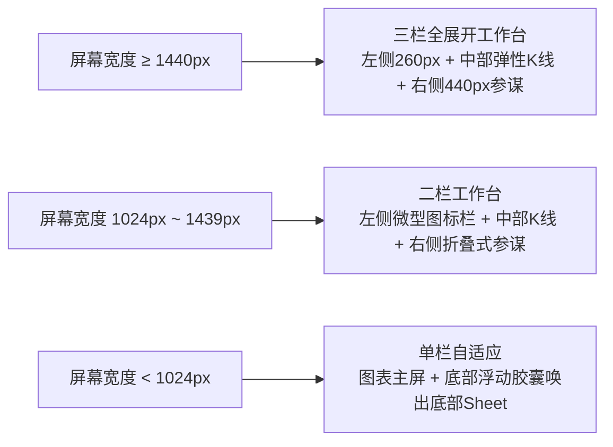

# SIDA Pro 数智参谋 · 顶级金融终端级 UI/UX 详细设计规范

> **方案定位**：对标 Bloomberg Terminal、TradingView Desktop、Linear 的现代化顶级金融量化交互质感。  
> **配套交互原型**：[sida_copilot_terminal_prototype.html](file:///C:/Users/19645/.gemini/antigravity/brain/569db8ea-0c0e-4928-9161-41d66542b43f/sida_copilot_terminal_prototype.html)

---

## 一、 视觉设计系统基石（Design System Foundation）

### 1. 曜石黑三层底色体系（Obsidian Dark Depth）
金融终端需要极高的数据专注度与夜间盯盘舒适度。抛弃传统灰调中后台设计，建立冷调高质感的三层深度：

| 层级 (Elevation) | 色值 (Token) | 用途说明 | 边框与光影 |
| :--- | :--- | :--- | :--- |
| **Layer 0 (Canvas)** | `#0B0E14` | 全局视口底色、图表深邃主舞台 | 无，纯粹沉浸暗夜基底 |
| **Layer 1 (Card & Rail)** | `#111722` | 左侧会话栏、右侧参谋面板、卡片容器 | `border: 1px solid rgba(255, 255, 255, 0.08)` |
| **Layer 2 (Hover & Active)** | `#161F2E` | 悬浮卡片、选中的会话项、快捷按钮 | `border-color: rgba(255, 255, 255, 0.16)` |
| **Layer 3 (Modal & Popover)**| `#1A2638` | 下拉菜单、五档盘口悬浮卡、步骤抽屉 | `box-shadow: 0 12px 32px -4px rgba(0,0,0,0.6)` |

### 2. 金融语义色彩与字体规范
* **涨跌语义高动态色彩**：
  * **上涨/买入多头**：`#F6465D`（中国红，饱和度优化，对比鲜明不刺眼）
  * **下跌/卖出空头**：`#0ECB81`（清透翡翠绿，暗色背景下辨识度极佳）
  * **风险警示/观望**：`#F59E0B`（科技琥珀黄，用于止损预警与中性震荡）
* **AI 科技专属色调**：
  * **极光青（Cyan）**：`#06B6D4` / 柔光阴影 `rgba(6, 182, 212, 0.2)`
  * **终端蓝（Indigo）**：`#3B82F6` / 柔光阴影 `rgba(59, 130, 246, 0.25)`
* **字体阶梯（Typography）**：
  * 文本字型：`-apple-system, "PingFang SC", "Segoe UI", sans-serif`
  * 数字与代码专用：**`JetBrains Mono` / `SF Mono` / `Roboto Mono`**（金额、价格、涨跌幅、代码必须使用等宽字体，保证盯盘时纵向对齐）

---

## 二、 核心组件重构规范与代码实现

### 1. 组件 1：数智裁决指标罗盘（DecisionCompassCard）
将原先扁平的文字列表升级为具有**仪表盘直观感**的卡片组件，包含**置信度徽章**、**动态价位区间轴**与**操盘预案**：

```tsx
// src/components/copilot/DecisionCompassCard.tsx
import React from 'react';

interface DecisionCardProps {
  ticker: string;
  tickerName: string;
  currentPrice: number;
  costPrice: number;
  supportPrice: number;
  resistancePrice: number;
  bias: 'bullish' | 'neutral' | 'bearish';
  biasLabel: string;
  confidence: number;
  tactics: string[];
  onDrawOnChart: () => void;
  onSetAlert: (price: number) => void;
}

export const DecisionCompassCard: React.FC<DecisionCardProps> = ({
  ticker,
  tickerName,
  currentPrice,
  costPrice,
  supportPrice,
  resistancePrice,
  biasLabel,
  confidence,
  tactics,
  onDrawOnChart,
  onSetAlert
}) => {
  // 计算现价在区间内的相对百分比
  const range = resistancePrice - supportPrice;
  const currentPct = Math.min(Math.max(((currentPrice - supportPrice) / range) * 100, 5), 95);
  const costPct = Math.min(Math.max(((costPrice - supportPrice) / range) * 100, 5), 95);
  const pnlPct = (((currentPrice - costPrice) / costPrice) * 100).toFixed(2);

  return (
    <div className="rounded-xl border border-cyan-500/30 bg-[#111724] overflow-hidden shadow-lg transition-all hover:border-cyan-500/50">
      {/* 头部：裁决徽章与置信度 */}
      <div className="flex items-center justify-between border-b border-white/[0.08] bg-gradient-to-r from-blue-950/70 via-[#131D2D] to-transparent p-3">
        <div className="flex items-center gap-2">
          <span className="flex items-center gap-1.5 rounded-md border border-amber-500/40 bg-amber-500/20 px-2.5 py-1 text-xs font-bold text-amber-300 shadow-sm">
            <span className="h-1.5 w-1.5 rounded-full bg-amber-400 animate-pulse" />
            {biasLabel}
          </span>
          <span className="text-[11px] text-slate-400">
            置信度 <strong className="text-slate-200 font-mono">{confidence}%</strong>
          </span>
        </div>
        <span className="text-[11px] font-mono text-cyan-400">多模型加权裁决</span>
      </div>

      {/* 中部：关键价位区间可视化罗盘 */}
      <div className="border-b border-white/[0.08] bg-[#0D131E] p-3 space-y-2">
        <div className="flex items-center justify-between text-[11px]">
          <span className="text-slate-400 font-medium">{tickerName} ({ticker}) 价位罗盘</span>
          <span className={`font-mono font-semibold ${Number(pnlPct) >= 0 ? 'text-rose-400' : 'text-emerald-400'}`}>
            持仓盈亏: {pnlPct}%
          </span>
        </div>

        {/* 水平区间轴 */}
        <div className="py-2.5">
          <div className="relative h-2 w-full rounded-full bg-slate-800 flex items-center">
            {/* 支撑点位 */}
            <div className="absolute left-[8%] h-2.5 w-2.5 rounded-full bg-emerald-400 ring-2 ring-emerald-950" />
            {/* 现价点位 */}
            <div 
              className="absolute h-3.5 w-3.5 -ml-1.5 rounded-full bg-cyan-400 ring-4 ring-cyan-950 shadow-[0_0_12px_rgba(6,182,212,0.8)] z-10"
              style={{ left: `${currentPct}%` }}
            />
            {/* 成本点位 */}
            <div 
              className="absolute h-2.5 w-2.5 -ml-1 rounded-full bg-amber-400 ring-2 ring-amber-950"
              style={{ left: `${costPct}%` }}
            />
            {/* 阻力点位 */}
            <div className="absolute right-[8%] h-2.5 w-2.5 rounded-full bg-rose-400 ring-2 ring-rose-950" />
          </div>

          {/* 标尺数值 */}
          <div className="flex justify-between text-[10px] font-mono pt-2 text-slate-400">
            <div className="text-emerald-400">
              <div>防守 {supportPrice.toFixed(2)}</div>
              <div className="text-[9px] text-slate-500">-3.9%</div>
            </div>
            <div className="text-cyan-300 font-bold text-center">
              <div>现价 {currentPrice.toFixed(2)}</div>
              <div className="text-[9px] text-slate-500">中位蓄势</div>
            </div>
            <div className="text-amber-300 text-center">
              <div>成本 {costPrice.toFixed(2)}</div>
              <div className="text-[9px] text-slate-500">保本位</div>
            </div>
            <div className="text-rose-400 text-right">
              <div>阻力 {resistancePrice.toFixed(2)}</div>
              <div className="text-[9px] text-slate-500">+8.7%</div>
            </div>
          </div>
        </div>
      </div>

      {/* 战术预案列表 */}
      <div className="p-3 bg-[#101622] space-y-1.5 text-xs text-slate-300">
        <div className="font-semibold text-slate-200">操盘战术预案：</div>
        <ul className="space-y-1.5 text-[11px] leading-relaxed">
          {tactics.map((tactic, idx) => (
            <li key={idx} className="flex items-start gap-1.5">
              <span className="font-bold text-cyan-400">{idx + 1}.</span>
              <span>{tactic}</span>
            </li>
          ))}
        </ul>
      </div>

      {/* 底部快捷操作 */}
      <div className="flex items-center justify-between border-t border-white/[0.08] bg-[#0A0E17] p-2.5">
        <div className="flex items-center gap-2">
          <button 
            onClick={onDrawOnChart}
            className="flex items-center gap-1 rounded bg-blue-600/30 hover:bg-blue-600/50 px-2.5 py-1 text-[11px] font-medium text-cyan-300 border border-cyan-500/40 transition"
          >
            在 K 线叠加画线
          </button>
          <button 
            onClick={() => onSetAlert(supportPrice)}
            className="rounded bg-[#141C2A] hover:bg-[#1A2536] px-2.5 py-1 text-[11px] text-slate-300 border border-white/[0.08] transition"
          >
            设置破位告警
          </button>
        </div>
        <button className="text-[11px] text-slate-400 hover:text-white transition">
          复制战报
        </button>
      </div>
    </div>
  );
};
```

---

### 2. 组件 2：多智能体会诊雷达（MultiAgentDebatePanel）
显性化展示技术面、资金面与题材环境三大维度的 Agent 独立诊断与置信度：

```tsx
// src/components/copilot/MultiAgentDebatePanel.tsx
import React from 'react';

export const MultiAgentDebatePanel: React.FC = () => {
  return (
    <div className="p-3 border-b border-white/[0.08] bg-[#101622] space-y-2">
      <div className="flex items-center justify-between">
        <span className="text-[11px] font-semibold text-slate-300 flex items-center gap-1.5">
          <span className="w-1.5 h-1.5 rounded-full bg-cyan-400" />
          多智能体会诊证据链 (3 票一致)
        </span>
        <span className="text-[10px] text-slate-500">TradingAgents 集群</span>
      </div>
      <div className="grid grid-cols-3 gap-1.5">
        <div className="p-2 rounded bg-[#141C2A] border border-white/[0.08]">
          <div className="text-[10px] text-slate-400">技术面 Agent</div>
          <div className="font-bold text-amber-300 font-mono text-xs mt-0.5">62分 · 震荡</div>
          <div className="text-[10px] text-slate-500 mt-1 truncate">缩量回踩未破位</div>
        </div>
        <div className="p-2 rounded bg-[#141C2A] border border-white/[0.08]">
          <div className="text-[10px] text-slate-400">资金与暗盘</div>
          <div className="font-bold text-rose-300 font-mono text-xs mt-0.5">48分 · 中性</div>
          <div className="text-[10px] text-slate-500 mt-1 truncate">主力净出1280万</div>
        </div>
        <div className="p-2 rounded bg-[#141C2A] border border-white/[0.08]">
          <div className="text-[10px] text-slate-400">题材与板块</div>
          <div className="font-bold text-emerald-300 font-mono text-xs mt-0.5">75分 · 活跃</div>
          <div className="text-[10px] text-slate-500 mt-1 truncate">永磁板块承接佳</div>
        </div>
      </div>
    </div>
  );
};
```

---

### 3. 组件 3：TradingView / Lightweight Charts 图元注入器
打通前端会话与图表实例的通信桥梁，实现点击一键上图：

```typescript
// src/services/chartOverlayService.ts
import { IChartApi, ISeriesApi } from 'lightweight-charts';

export interface PriceLevelOverlay {
  price: number;
  title: string;
  color: string;
  lineStyle?: number; // 0: solid, 1: dotted, 2: dashed
}

export class ChartOverlayService {
  private static linesMap: Map<string, any> = new Map();

  /**
   * 将参谋推导的关键点位直接绘制在当前 K 线图表上
   */
  public static injectDecisionLevels(
    series: ISeriesApi<'Candlestick'>,
    levels: PriceLevelOverlay[]
  ) {
    // 先清理上一次注入的线
    this.clearOverlays(series);

    levels.forEach((lvl) => {
      const priceLine = series.createPriceLine({
        price: lvl.price,
        color: lvl.color,
        lineWidth: 2,
        lineStyle: lvl.lineStyle ?? 2,
        axisLabelVisible: true,
        title: lvl.title,
      });
      this.linesMap.set(`${lvl.title}_${lvl.price}`, priceLine);
    });
  }

  public static clearOverlays(series: ISeriesApi<'Candlestick'>) {
    this.linesMap.forEach((line) => {
      try {
        series.removePriceLine(line);
      } catch (e) {
        // ignore
      }
    });
    this.linesMap.clear();
  }
}
```

---

## 三、 工作台三栏响应式网格布局规则

在宽屏显示器（≥ 1440px）上，默认采用**三栏专业操盘布局**；在中小屏或窄屏上自动折叠或退化为抽屉流：



### 栅格与尺寸参数：
1. **左侧监控雷达栏（Left Radar Rail）**：
   * 宽度：固定 `260px`
   * 支持一键收起为 `48px` 图标模式
2. **中间行情图表舞台（Center Stage）**：
   * 宽度：`flex-1 min-w-[500px]`
   * 承载 Lightweight Charts K 线与副图，图表保持自适应宽高重绘
3. **右侧数智参谋决策流（Right Copilot Stream）**：
   * 宽度：默认 `440px`（黄金阅读宽度，保证指标罗盘水平轴不被截断）
   * 顶部提供三个快捷控制：`全屏展开`、`固定吸附`、`最小化为胶囊`

---

## 四、 升级效果对比总结

| 体验维度 | 当前线上版本（v0.87.0） | 顶级金融终端重构后（v0.88.0） |
| :--- | :--- | :--- |
| **视觉基调** | 平铺灰暗色（`#161e2e`），缺少层级 | **曜石黑三层体系（`#0B0E14` / `#111722`）+ 1px 微光边框** |
| **核心裁决呈现** | 纯文本 Bullet Points（文字堆叠） | **数智裁决指标罗盘 Widget（水平价位轴 + 盈亏比可视化）** |
| **图文联动性** | 仅有一个 `600111 看工作台↗` 外跳链接 | **一键在 K 线上绘制支撑/阻力通道，K 选区反向召唤参谋** |
| **多模型协同感知**| 单一模型名称展示，后台黑盒 | **技术面 / 资金面 / 情绪面三方 Agent 会诊卡片与置信度显性化** |
| **盯盘扫读效率** | 需通篇阅读文字才能找出防守位与阻力位 | **0.5 秒扫读区间轴线，核心支撑阻力与盈亏比一目了然** |
