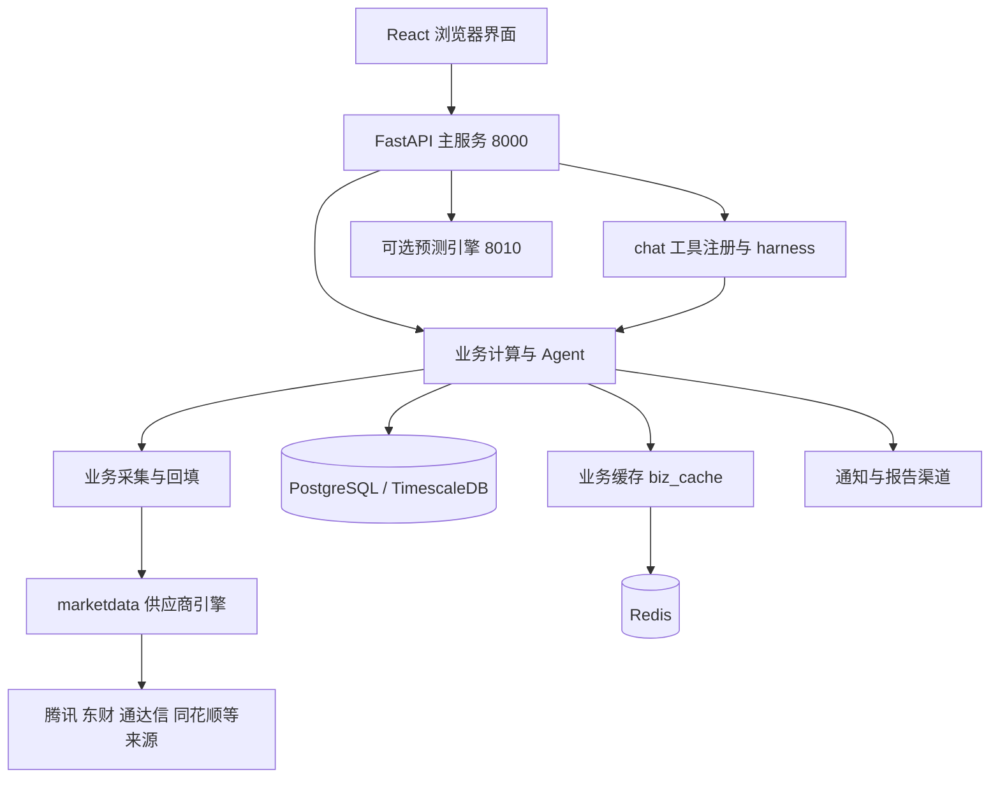

# SIDA 架构与代码入口

> 基线标识：`d774ae01`，`VERSION=v0.80.0`；盘点日期：2026-10-26。
> 盘点对象：`/Users/winter/Documents/zicalWork/sida-pro`。
> 覆盖范围：bootstrap、数据库/缓存、marketdata 宿主适配、Agent/chat/harness、前端路由、预测服务边界的重点静态阅读；Python 模块清单见 code-index.md。
> 未覆盖：逐函数正确性审计、全部页面视觉与交互、外部供应商数据准确性和预测模型运行验收。

## 运行关系

该图概括常见链路。部分 TQ/L2/专项采集使用独立适配器，不能把它理解为每个外部调用都必经 marketdata。索引中的模块文档字符串可能早于当前实现。

## 启动装配

| 阶段 | 实现与职责 |
| --- | --- |
| 兼容入口 | `server.py`：构造 app、转发历史属性、调用 CLI；不维护人工 Agent 注册表 |
| HTTP 进程 | `src/bootstrap/cli.py`：uvicorn、监听地址、worker 数、开发 reload |
| 应用装配 | `src/bootstrap/app.py`：发现 Agent、挂 lifespan、挂静态 SPA；未知 API 和缺失静态资源返回 404 |
| 环境准备 | `src/bootstrap/env.py`：日志、代理、SSL、Playwright |
| 生命周期 | `src/bootstrap/startup.py`：数据库门禁、初始化/迁移、认证初始化、种子、自检、选主与调度 |
| 运行上下文 | `src/bootstrap/runtime.py`：scheduler 实例、Agent 触发与上下文 |
| 数据源初始化 | `src/bootstrap/datasources.py`：数据源对账、策略、样例股票 |
| HTTP 应用 | `src/web/app.py`：路由 prefix、middleware、鉴权和 API 装配 |

Docker 必须显式设置 `WEB_HOST=0.0.0.0` 才能接受容器端口转发。宿主暴露范围由端口映射决定，本地编排只绑定 `127.0.0.1:8000`。

## 数据层

`packages/marketdata/` 是独立 Python 包，通过 `ConfigProvider` 和 `MetricsSink` 两个端口接入宿主。核心文件为 `client.py`、`engine.py`、`registry.py`、`types.py`、`symbol.py`、`http.py` 与 `vendors/`。供应商负责请求及规范化，Engine 管理主备链与适用缓存。

宿主入口为 `src/core/marketdata_client.py`：`DbConfigProvider` 从 DataSource 读配置，`get_market_data()` 提供单例，并接入共享缓存/指标。`src/collectors/` 进一步处理业务需要的采集、归档、回填和日期/市场差异。

| 数据 | 首要定位 |
| --- | --- |
| K 线 | `src/collectors/kline_collector.py`、`klines_ingestor.py`、`src/db/klines_repo.py` |
| 股票列表 | `src/collectors/stock_list.py` |
| 新闻/事件 | `src/collectors/news_collector.py`、`events_collector.py` |
| 资金四档 | `src/collectors/capital_flow_collector.py` |
| TQ 情绪/公式 | `src/collectors/tq_sentiment_series.py`、`tq_formula_signals.py` |
| 逐笔/暗盘/筹码 | `src/core/tdx_tick_parser.py`、`dark_flow_fusion.py`、`tq_chips.py` |
| 市场宽度与题材 | `src/core/market_breadth.py`、`theme_mood.py` |

API 中的“有返回值”不等于新鲜数据；必须检查日期、来源、降级说明和单位。详见 [业务契约](contracts.md)。

## 存储与缓存

| 入口 | 职责 |
| --- | --- |
| `src/db/dialect.py` | 数据库环境解析、PG/SQLite 判断、引擎构造、读写路由和 SQL 方言助手 |
| `src/db/session.py` | Base、读写引擎、Session 与依赖注入 |
| `src/db/models.py` | ORM 模型，包含 User、ChatConversation、行情和运行记录 |
| `src/web/database.py` | init_db 及历史 re-export；创建缺表后执行版本化迁移 |
| `src/web/migrations.py` | 唯一版本化 schema 变更入口 |
| `src/db/backup.py` | 迁移前备份能力 |
| `src/web/cache/biz_cache.py` | 业务缓存 L1 内存 + L2 Redis，`biz:` 前缀 |

`src/web/models.py` 是兼容薄壳，新代码优先从中立的 `src/db/` 导入。基础设施 Redis 用途（调度锁、Streams）与业务缓存语义不同，不应照搬其连接方式到业务代码。

## Agent 与 AI 对话

调度 Agent 的注册与工具调用注册是两套机制：

- **Agent 类**：实现放 `src/agents/`，使用 `@register_agent`；`src/bootstrap/agents.py` 自动发现；`src/core/agent_catalog.py` 定义种子、workflow/capability、可见性与调度默认值。
- **chat 工具**：`src/agents/chat/registry.py` 维护 `CHAT_TOOL_REGISTRY` 和 schema/预算/权限；工具实现包括 `tools_market.py`、`tools_thsdk.py` 与 `tools_catalog.py`。HTTP 对话入口为 `src/web/api/chat.py`。
- **参谋运行治理**：`src/harness/runtime.py` 管工具白名单和调用预算；`routing.py` 路由，`recipes.py` 与 `recipes/*.yaml` 定义配方，`trace.py` 记录证据；`src/core/copilot_runtime.py` 管运行状态、心跳和中断接管。

自动发现共 9 个注册类：盘前展望、盘中监控、日报、新闻摘要、图表分析、个股归因、主题启动探测、竞价复盘和 TradingAgents。注册数量不等于当前启用数量，后台是否运行还取决于用户配置、catalog 和调度选主。

## 前端边界

技术栈为 React 18、TypeScript、Vite、Tailwind、React Router 与 TanStack Query。`frontend/src/App.tsx` 是实际路由和导航权限入口；`frontend/src/pages/` 是页面；`frontend/packages/api`、`base-ui`、`biz-ui` 提供 workspace 包。

| 领域 | 主要路由/页面 |
| --- | --- |
| 市场 | `/` Dashboard、`/heatmap`、`/theme-mood` |
| 标的 | `/portfolio` Stocks、`/stocks/:symbol` StockWorkbench |
| 机会 | `/opportunities`、`/auction`、`/dark-fund-top`、`/war-report`、`/replay-tree` |
| AI 参谋 | `/ai-copilot`、`/copilot/runs`、`/copilot/agents`、`/copilot/tools` 等 |
| 决策证据 | `/decision-ledger`、`/caliber-compare`、`/factor-ic` |
| 报告/账户 | `/reports`、`/shadow`、`/notifications`、`/profile` |
| 系统 | `/system`、`/settings`、`/admin`、`/api-keys` |

`/forecast`、`/quote`、`/l2`、`/agents`、`/history` 等存在兼容重定向，不能按页面文件名猜现在的入口。菜单隐藏属于界面行为，实际授权仍须由后端执行。

## 预测与可观测性

主服务通过 HTTP 调用 `forecast_server.py`，计算在 `forecast_lib/`。主服务禁止直接 import forecast_lib；预测侧禁止 import src。预测侧回调必须遵守 [服务依赖方向](../dependency_direction.md) 的白名单与 `X-Service-Token` 鉴权。

`/api/health` 报告版本、数据库、Redis、业务缓存、调度和预测状态；外网请求可能只得到精简信息。响应经过统一 envelope，应读取 `data.status`、`data.version` 和 `data.components`。预测 down 不单独翻转整体健康状态。

`docker-compose.infra.yml` 与主 compose 提供可选 Prometheus、Grafana、Loki、Promtail、Alertmanager。本地最小栈只运行主服务、PG 与 Redis。
